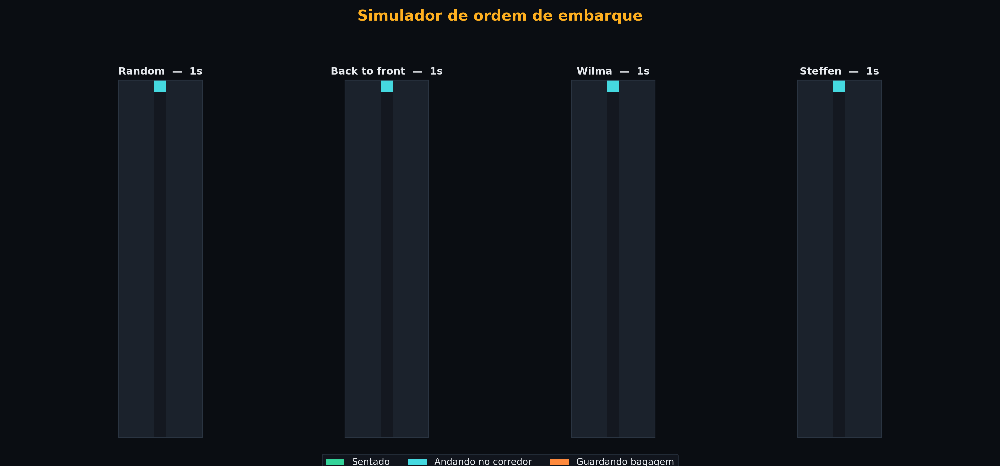
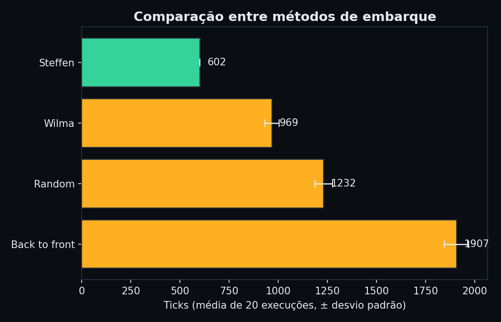
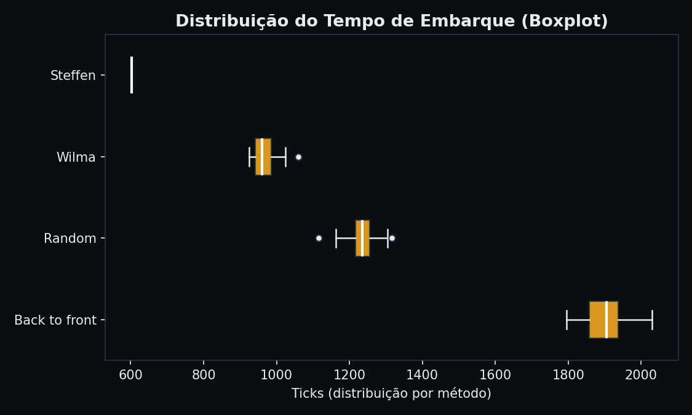

*[Read this in English](README.en.md)*

# Simulador de Ordem de Embarque



Simulação em Python que compara diferentes métodos de embarque de passageiros em uma aeronave comercial, medindo o tempo total (em "ticks") necessário para que todos estejam sentados. Gera gráficos estatísticos (médias com desvio padrão e boxplot de distribuição) e uma animação visual dos métodos operando simultaneamente lado a lado.

---

## Como rodar

### 1. Pré-requisitos e Instalação

Recomenda-se Python 3.8 ou superior. Instale as dependências listadas no [requirements.txt](requirements.txt):

```bash
pip install -r requirements.txt
```

### 2. Execução da Simulação

Execute o simulador com as configurações padrão:

```bash
python airplane_simulator.py
```

### 3. Argumentos de Linha de Comando

Você pode personalizar os parâmetros da simulação via argumentos CLI:

| Argumento | Descrição | Padrão |
|---|---|---|
| `--rows` | Número de fileiras do avião | `30` |
| `--seats-per-row` | Número de assentos por fileira | `6` |
| `--trials` | Número de simulações por método | `20` |
| `--seed` | Semente do gerador aleatório para reprodutibilidade | `42` |
| `--entry-delay` | Intervalo de leitura de cartão no portão / fila externa (ticks) | `1` |
| `--family-ratio` | Proporção de passageiros em grupos familiares | `0.15` |
| `--min-stow` | Tempo mínimo para guardar bagagem | `5` |
| `--max-stow` | Tempo máximo para guardar bagagem | `25` |
| `--seat-delay` | Tempo extra quando passageiro sentado precisa dar passagem | `10` |
| `--no-gif` | Pula a geração da animação GIF (execução ultra rápida) | `False` |
| `--output-dir` | Diretório de saída dos arquivos gerados | Diretório do script |

**Exemplo de execução rápida (apenas estatísticas e gráficos):**

```bash
python airplane_simulator.py --trials 50 --rows 30 --no-gif
```

### 4. Executando os Testes

Para rodar a suíte de testes unitários automatizados:

```bash
python -m unittest test_simulator.py
```

---

## O que o script faz

1. **Configuração da aeronave**: Modela um avião de `rows` fileiras × `seats_per_row` assentos (padrão: 30 fileiras, 6 assentos por fileira no layout `Janela | Meio | Corredor || Corredor | Meio | Janela`).
2. **Tempo de bagagem fixado por passageiro**: Sorteia, com seed fixa, um tempo individual de guardar bagagem (`min_stow` a `max_stow`). O tempo é o mesmo em todos os métodos, isolando o impacto exclusivo da **ordem de embarque**.
3. **Fila externa e portão**: Modela o intervalo de leitura de cartão no portão (`--entry-delay`), simulando o fluxo de entrada no corredor.
4. **Grupos familiares**: Modela passageiros viajando juntos em assentos adjacentes (`--family-ratio`). Membros da mesma família embarcam em sequência quando o primeiro é chamado.
5. **Física do corredor**: Simula tick a tick um corredor de passagem única. Passageiros guardando bagagem travam o avanço de quem vem atrás e passageiros já sentados no corredor/meio geram tempo extra de desocupação (`seat_delay`).
6. **Repetibilidade estatística**: Executa cada método por múltiplos trials (`--trials`, padrão 20) com seed controlada (`--seed`, padrão 42).
7. **Artefatos gerados**:
   - `comparacao_metodos.png`: gráfico de barras comparando as médias (± desvio padrão).
   - `boxplot_metodos.png`: boxplot com a distribuição detalhada dos tempos.
   - `embarque_animado.gif`: animação lado a lado dos 4 métodos.

---

## Métodos de embarque simulados

| Método | Descrição |
|---|---|
| **Random** | Ordem aleatória de passageiros. |
| **Back to front** | Embarque por zonas, das fileiras traseiras para as dianteiras. |
| **Wilma** | Agrupamento por tipo de assento: janela primeiro, depois meio, depois corredor (*Window, Middle, Aisle*). |
| **Steffen** | Método determinístico inspirado no físico Jason Steffen: alterna fileiras pares/ímpares em assentos de janela, meio e corredor para minimizar interferências entre passageiros vizinhos. |

---

## Resultados

### Tabela Comparativa

Resultados obtidos com os parâmetros padrão (30 fileiras, 180 passageiros, 20 trials, seed 42):

| Posição | Método | Média (ticks) | Desvio Padrão | Mínimo (ticks) | Máximo (ticks) |
|:---:|---|:---:|:---:|:---:|:---:|
| 1º | **Steffen** | 602.0 | 0.0 | 602 | 602 |
| 2º | **Wilma** | 968.7 | 36.1 | 925 | 1059 |
| 3º | **Random** | 1231.8 | 45.1 | 1116 | 1316 |
| 4º | **Back to front** | 1907.5 | 61.6 | 1796 | 2030 |

### Saída no Terminal

```
Configuração:
  - Fileiras: 30 | Assentos/fileira: 6 | Total passageiros: 180
  - Repetições (trials): 20 | Seed: 42
  - Fila externa (entry delay): 1 tick(s)
  - Grupos familiares: 10 famílias (24 passageiros, ~15%)

Rodando 20 simulações por método...

Random          media= 1231.8  desvio_padrao=  45.1  min= 1116  max= 1316  (20 trials)
Back to front   media= 1907.5  desvio_padrao=  61.6  min= 1796  max= 2030  (20 trials)
Wilma           media=  968.7  desvio_padrao=  36.1  min=  925  max= 1059  (20 trials)
Steffen         media=  602.0  desvio_padrao=   0.0  min=  602  max=  602  (20 trials)

Arquivos gerados: comparacao_metodos.png, boxplot_metodos.png, embarque_animado.gif
```

### Gráficos Gerados

#### Comparação de Médias


#### Distribuição Completa (Boxplot)


---

## Licença

Este projeto está sob a licença [MIT](LICENSE).
